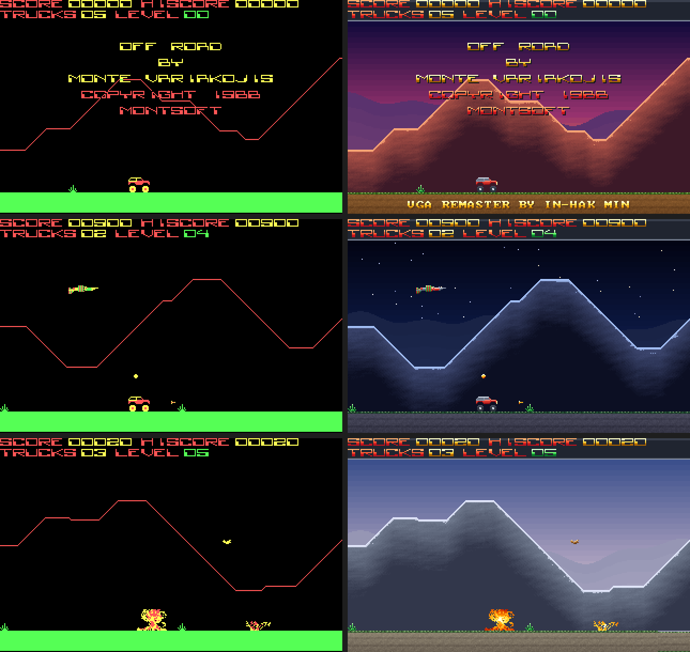

# Off-Road — C 변환 + VGA 256색 리마스터

**OFF-ROAD** (1988, Monte Variakojis / MONTSOFT, IBM PC CGA, 사용자 지원 소프트웨어) 의 원본 실행 파일
`OFFROAD.EXE` 를 역어셈블해 C 로 옮기고, 256색 VGA 판을 새로 만든 것입니다.

## 바로 실행

`release/` 폴더를 통째로 도스나 DOSBox 에 넣고 실행합니다.

| 파일 | 내용 |
|---|---|
| `ORVGA.EXE` | VGA 256색 리마스터 판 |
| `ORC.EXE` | 원본과 똑같이 동작하는 판 (CGA 네 색) |
| `CWSDPMI.EXE` | 32비트 도스 실행 도우미 (두 판 모두 필요) |

처음에 원판처럼 기계를 고릅니다 (1 = IBM PC/XT … 5 = PS/2 386).  옮긴 판은 고른 기계에서 원판이 돌던
빠르기를 흉내 냅니다 — **3) IBM AT** 가 원작자가 맞춘 보통 빠르기(초당 약 25 프레임)입니다.

조작: → 가속, ← 감속, ↑ 점프, SPACE 쏘기, P 멈춤, Ctrl+R 다시 시작, ESC 도스로, Ctrl+Q 바로 종료.
자세한 내용은 [`release/README.TXT`](release/README.TXT).

### 추천 사양

| | 최소 | 권장 |
|---|---|---|
| CPU | 386 (조금 느려짐) | 486 이상 |
| 메모리 | 2MB | 4MB |
| 그래픽 | ORC: CGA 호환 / ORVGA: VGA | VGA |

DOSBox cycles=26800 (486급) 에서 두 판 모두 AT 모드 원래 빠르기 (CGA 25.7, VGA 25.3 프레임/초) 가 납니다.

## VGA 개선 사항

- 하늘: 레벨마다 다른 테마 (제목 노을, 사막 낮, 붉은 협곡, 노을, 달밤과 별, 새벽 안개, 초원, 화산, 설산)
- 먼 산 실루엣이 산 능선보다 느리게 흐르는 시차 스크롤
- 원판의 한 점 굵기 산 능선 → 결과 음영이 있는 산, 빛나는 능선
- 초록 띠 땅 → 풀 가장자리와 바퀴 자국이 있는 흙길, 트럭 속도만큼 흐른다
- 스프라이트 65종을 재질별로 다시 칠함: 빨간 트럭(은색 휠, 고무 타이어, 유리창, 전조등),
  불꽃 폭발, 나무 상자, 돌, 강철 미사일, 국방색 헬기/비행기, 보라색 괴물 얼굴 …
- 트럭 서스펜션: 공중에서는 바퀴가 처지고, 착지하면 차체가 내려앉았다 튀어 오른다 (그림만, 게임 동작은 그대로)
- 점수판: 금속 판 위 그러데이션 글자, 제목에 "VGA REMASTER BY IN-HAK MIN"
- 게임 동작과 그림 모양은 원판 그대로 (점 하나 바꾸지 않고 색만 새로)

## 만든 방법

- 원본은 55KB 손 어셈블리 (자료 세그먼트 0020, 코드 세그먼트 089D).  `tools/asm2c.py` 가 프로그램 전체를
  C 함수 하나(`or_code.c`)로 기계 번역합니다.  레지스터는 전역 변수, 메모리는 실모드 주소 그대로의 배열이라
  스택 내용까지 원본과 같습니다.
- 원본은 인터럽트를 걸지 않고 CPU 속도로 돕니다 (프레임마다 `mov cx,[004C] / loop $`, 키는 BIOS 자판 버퍼를
  직접 들여다봄).  옮긴 C 는 프레임 끝을 '폴 지점' 으로 삼아 거기서 자판 스캔 코드를 BIOS 버퍼에 넣고,
  블록마다 8088 클럭을 어림해 더해 고른 기계의 빠르기로 시간을 맞춥니다 (`sys_dos.c`).
- 원본을 unicorn 에뮬레이터(`tools/emu.py`)로 돌린 것과 옮긴 C(`hosttest.exe`, 256색판 `hostvga.exe`)를 같은
  키 대본으로 돌려 폴 지점마다 레지스터와 메모리 전체를 비교했습니다 (`tools/difftest.py`, 무작위 대본 +
  레벨 1~9 를 시험용 무한 목숨/레벨 건너뛰기(`INF=1 WARP=n`)로: 모두 같음).
- 256색판(`orvga.c`)은 프레임마다 CGA 화면과 게임 변수를 읽어 새로 짓습니다: XOR 스프라이트는 그리기/지우기
  짝을 목록으로 따라가 `tools/mkvga.py` 가 미리 칠한 그림으로, 산은 원판의 능선 높이표로, 글자는 꼬리표로.

## 빌드

- 도스판: djgpp — `build.bat` (ORC.EXE), `build.bat vga` (ORVGA.EXE)
- 시험판(윈도우, MSYS2 mingw gcc): `sh build_host.sh [vga]`
- 번역 다시 만들기: 원본 `OFFROAD.EXE` 를 `orig/` 에 두고 `sh regen.sh [vga]`
  (Python 3 + capstone, unicorn, Pillow).  원본 실행 파일은 저장소에 넣지 않았습니다.
- 대조: `python tools/monkey.py 씨앗 틱 > 대본.txt` → `EVERY=5 python tools/difftest.py 대본.txt 틱`
  (`HOST=hostvga.exe` 면 256색판), DOSBox 찍기: `python tools/dosshot.py 대본.txt 결과.png orvga.exe`
  (창을 띄우지 않고 돈다; `REAL=1 CYCLES=26800` 이면 실제 빠르기를 잰다)
